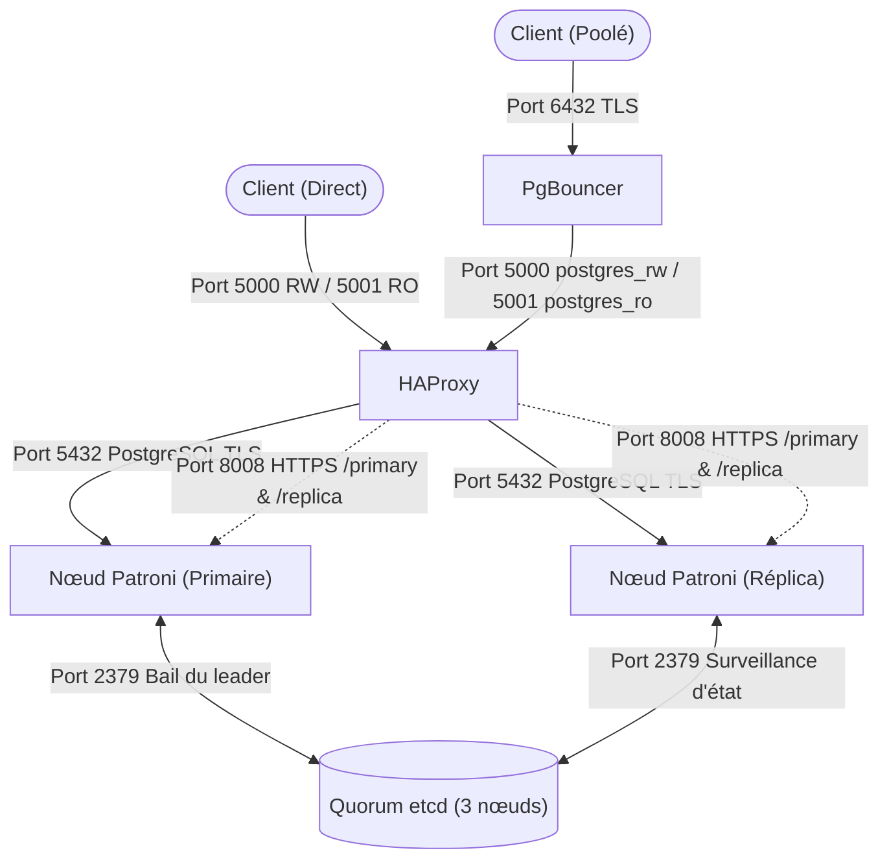

# Cluster PostgreSQL Haute Disponibilité (HA) Durci — RHEL 8

> **Langue :** Français | [English](README.md)

Ce dépôt implémente un laboratoire **PostgreSQL 17** haute disponibilité basé sur des images **Red Hat UBI 8**, orchestré par **Patroni 4.1.0** et **etcd 3.6**, avec un routage via **PgBouncer** et **HAProxy**, une orchestration alternative **Ansible** et une console web d'administration en **Go** (`mgmt-app`).

## Architecture du système

Les clients se connectent soit directement à HAProxy (`5000` lecture-écriture, `5001` lecture seule), soit via PgBouncer (`6432`), qui mutualise les connexions avant de les relayer vers HAProxy puis vers les nœuds PostgreSQL gérés par Patroni et etcd.

👉 **Détails complets : [Architecture et Flux](documentation/architecture.md)**

---

## Espace Documentation

Retrouvez ici l'ensemble des guides en français pour l'installation, l'exploitation et la maintenance du cluster :

### Démarrage
- [**Guide de démarrage rapide**](documentation/QUICKSTART.md) : déployer et vérifier le cluster via `Makefile`.
- [**Images Docker**](documentation/docker_images.md) : hiérarchie, construction et rôle des conteneurs UBI 8.
- [**Sources des paquets**](documentation/package_sources.md) : origine des RPMs et paquets Python (UBI, PGDG, EPEL, PyPI).

### Administration et exploitation
- [**Index des procédures**](documentation/procedures/README.md) : sauvegarde, restauration et maintenance etcd, Patroni, HAProxy et PgBouncer.
- [**Guide des scripts**](documentation/scripts/README.md) : description des outils d'automatisation dans `scripts/`.
- [**Matrice des tests**](documentation/tests.md) : validations externes, internes, test de charge et bascule automatique.
- [**Console de gestion Go**](mgmt-app/README.md) et [**Manuel d'utilisation**](mgmt-app/Manuel_Utilisation.md) : pilotage web sur `https://localhost:8080`.
- [**Orchestration Ansible**](ansible/README-ansible.md) : déploiement alternatif via `ansible/site.yml` et `ansible/verify.yml`.

### Sécurité et durcissement
- **Chiffrement TLS** : communications chiffrées pour etcd, l'API REST Patroni, PostgreSQL, HAProxy et PgBouncer.
- **Contrôle mTLS configurable** : piloté par `VERIFY_CLIENT_CERT` dans `.env`.
- **Isolation des rôles** : comptes distincts pour l'administration etcd, Patroni, la réplication et le superutilisateur PostgreSQL.

*(Note : la documentation Diátaxis complète en anglais se trouve dans [`docs/index.md`](docs/index.md).)*

---

## Rapports et audit

Chaque exécution de la suite complète génère un rapport horodaté :
- **Rapports d'audit :** générés dans `./reports/`.
- **Lancer l'audit complet :** `make big-test`
- **Vérifications hors ligne (tests Go et documentation) :** `cd mgmt-app && go test ./...` et `python3 -m unittest discover -s tests -p "test_*.py" -v`

---
[Accéder au guide de démarrage rapide](documentation/QUICKSTART.md)
