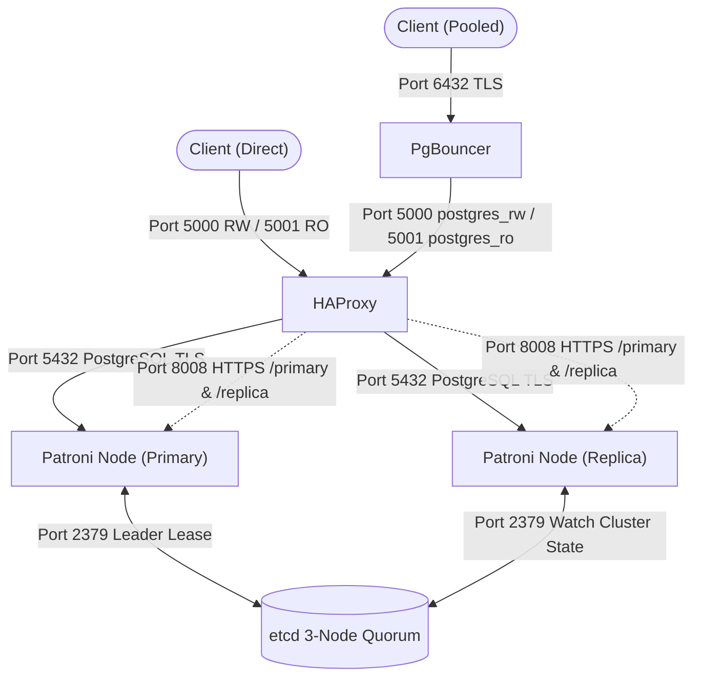

# Hardened High-Availability PostgreSQL Cluster on RHEL 8

> **Language:** English | [Français](README.fr.md)

This repository provides a containerized High-Availability (HA) **PostgreSQL 17** lab built on **Red Hat UBI 8**, orchestrated by **Patroni 4.1.0** and **etcd 3.6**, with connection routing through **PgBouncer** and **HAProxy**, an optional **Ansible** deployment path, and a **Go** cluster management web console (`mgmt-app`).

## Architecture Overview

Application clients connect either directly to HAProxy (`5000` read-write, `5001` read-only) or through PgBouncer (`6432`), which pools sessions before forwarding queries to HAProxy and then to the active PostgreSQL nodes managed by Patroni and etcd.



## Documentation Portal (Diátaxis)

English engineering and lab documentation lives under [`docs/`](docs/index.md):

- **Tutorials:** [Getting Started & Failover Labs](docs/01-tutorials/index.md) — deploy the 8-container cluster, inspect health checks, and run controlled failover drills.
- **How-To Guides:** [Operational Runbooks](docs/02-how-to-guides/index.md) — step-by-step procedures for TLS certificate generation, switchovers, and etcd snapshot backups.
- **Reference:** [Architecture Ports, Environment & CLI](docs/03-reference/index.md) — complete tables of Compose services, ports, environment variables, `Makefile` targets, and automation scripts.
- **Explanation:** [Consensus, Routing & Security Posture](docs/04-explanation/index.md) — design overview of etcd Raft consensus, Patroni failover priority across DC1/remote nodes, and lab security settings.

French legacy operational documentation and subproject guides are linked from [README.fr.md](README.fr.md).

## Quick Start

1. Inspect the environment variables in `.env` (or copy the template file `".env example"` to `.env` if needed).
2. Validate the Docker Compose manifest and generate local SSH keys, TLS certificates, and PgBouncer user entries:

```bash
docker compose -f docker-compose.yml config -q
make gen-ssh gen-certs setup-pgbouncer
```

3. Build the RHEL 8 UBI container images and start the 8-node stack (`etcd1..3`, `node1..3`, `haproxy`, `pgbouncer`):

```bash
make build
make up
```

4. Verify etcd quorum, Patroni leader election, HAProxy routing, and PgBouncer pooling:

```bash
make status
make verify
make verify-cluster
```

## Management Console & Automated Tests

- **Go Management App (`mgmt-app/`):** Provides a web dashboard (`https://localhost:8080`), etcd key explorer, container controls, and audit views. Run `cd mgmt-app && go test ./...` to execute Go unit tests, or launch with `make mgmt-run`.
- **Ansible Deployment (`ansible/`):** Alternative playbook orchestration via `ansible/site.yml` and `ansible/verify.yml` (`make ansible-all`).
- **Full Audit Runner (`make big-test`):** Runs `scripts/manage/big_test.sh` and saves timestamped Markdown reports into `./reports/`.
- **Offline Documentation & Syntax Verification:** Run `python3 -m unittest discover -s tests -p "test_*.py" -v` to validate scripts, YAML manifests, Compose syntax, Mermaid diagrams, and Diátaxis rules without needing a running Docker cluster.
