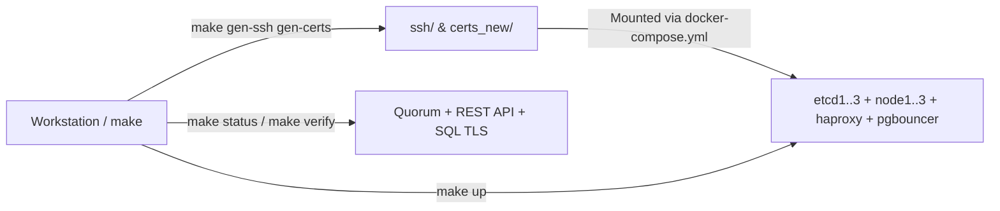

# Tutorial 1: Deploy and Verify the Patroni RHEL 8 Cluster

In this tutorial, you prepare the Docker Compose environment, generate lab SSH and TLS assets, start the 8-container RHEL 8 UBI stack, and verify cluster health across etcd, Patroni, HAProxy, and PgBouncer.

- **Estimated Time:** 15–20 minutes (depends on image build cache)
- **Target Stack:** Docker Compose (`docker-compose.yml`), `Makefile`, RHEL UBI 8 images

## Prerequisites

Ensure your workstation provides:

- **Docker Engine** with the **Docker Compose** plugin (`docker compose version`)
- **GNU Make** and **Bash**
- **OpenSSL** (`openssl`), `envsubst`, and **Python 3**
- Outbound registry access to `registry.access.redhat.com/ubi8/ubi`, PGDG, EPEL, and PyPI when building images from scratch

## Architecture Flow



## Step 1: Validate the Environment File and Compose Manifest

Verify `.env` contains every required credential and port variable (copy from `".env example"` if `.env` was removed locally):

```bash
cp -n ".env example" .env 2>/dev/null || true
make check-env
docker compose -f docker-compose.yml config -q
```

Expected output from `make check-env`:

```text
🔍 Vérification du fichier .env...
✅ Toutes les variables obligatoires sont présentes.
```

## Step 2: Generate SSH Keys, TLS Certificates, and PgBouncer Credentials

Generate the cluster SSH keypair, create the SAN-enabled TLS certificates into `certs_new/`, and render PgBouncer's authentication list:

```bash
make gen-ssh
make gen-certs
make setup-pgbouncer
```

Notice `docker-compose.yml` mounts `./certs_new:/certs:rw` into all `etcd*`, `node*`, `haproxy`, and `pgbouncer` containers, and `Dockerfile.base` copies `ssh/id_rsa*` into `/root/.ssh/`.

## Step 3: Build Images and Start the 8-Service Cluster

Build the layered UBI 8 images in dependency order (`patroni-rhel8-base` followed by `etcd`, `postgresql`, `haproxy`, and `pgbouncer`), then launch the detached stack:

```bash
make build
make up
make ps
```

Expected services in `make ps`: `etcd1`, `etcd2`, `etcd3`, `node1`, `node2`, `node3`, `haproxy`, and `pgbouncer`.

## Step 4: Inspect Cluster Status and Run Component Tests

Wait roughly 30 seconds for etcd consensus and PostgreSQL initialization to complete, then inspect status and run component checks:

```bash
make status
make etcd
make verify
make test-pgbouncer
```

Expected checks in `make verify`:

- `scripts/tests/test_etcd.sh`: verifies HTTPS `/health`, 3-node quorum (`etcd1`, `etcd2`, `etcd3`), and `patroni` key-prefix write access.
- `scripts/tests/test_patroni.sh`: verifies Patroni HTTPS REST `/health`, primary identification via `patronictl -c /etc/patroni.yml list`, SSL `on`, and direct SQL writes.
- `scripts/tests/test_haproxy.sh`: verifies HAProxy TLS statistics on port `7000` and SQL routing across port `5000` (RW) and `5001` (RO).
- `scripts/tests/test_dck_pgbouncer.sh`: verifies pooled connections through PgBouncer port `6432` to `postgres_rw` and `postgres_ro`.

## Step 5: Tear Down the Lab

Stop and remove containers and volumes cleanly when finished:

```bash
make down
```

Use `make cleanup` only when you also want to delete local Docker images and generated `ssh/`, `certs/`, and `reports/` assets.

## Next Steps

- Continue to [Tutorial 2: Observe Patroni Failover and Primary Reintegration](02-failover-and-recovery-lab.md).
- Review service ports and `Makefile` targets in [Reference: Ports, Environment, and Scripts](../03-reference/architecture-ports-and-env.md).
