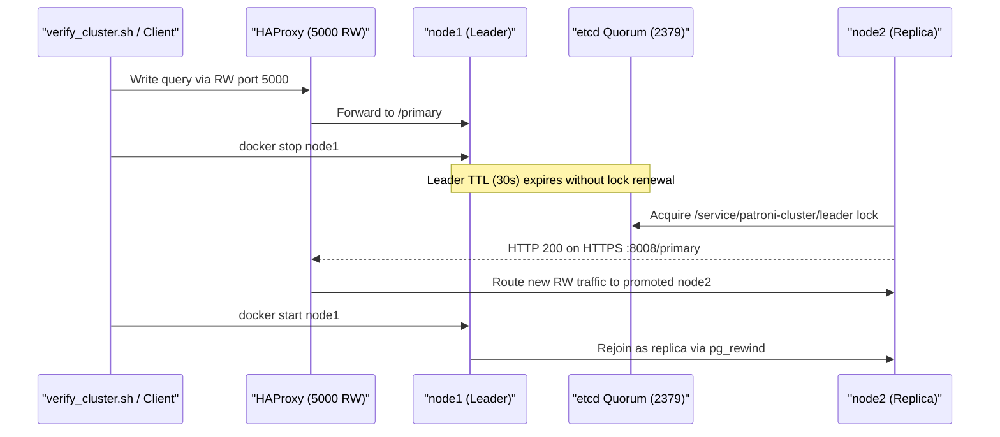

# Tutorial 2: Observe Patroni Failover and Primary Reintegration

In this tutorial, you exercise the load generator (`stress_test.py`), run an automated primary-container failure test, and observe how etcd consensus and Patroni `pg_rewind` restore cluster redundancy.

- **Estimated Time:** 10 minutes
- **Prerequisites:** Completed [Tutorial 1](01-deploy-and-verify-cluster.md) with all 8 containers running

## Failover Lifecycle



## Step 1: Confirm Initial Leader Topology

Inspect the current Patroni member table before simulating any failure:

```bash
docker exec node1 patronictl -c /etc/patroni.yml list
```

Record which node (`node1`, `node2`, or `node3`) holds the `Leader` role and note the current Timeline (`TL`) number.

## Step 2: Run the Multi-Threaded Load Generator

Send a short burst of SSL-verified SQL queries through HAProxy port `5000` using `scripts/tests/stress_test.py`:

```bash
python3 scripts/tests/stress_test.py --help
docker exec node1 env CERT_DIR=/etc/patroni/certs PGPASSWORD=pg_password \
  python3 /scripts/tests/stress_test.py \
  --type haproxy --host haproxy --port 5000 --threads 2 --max-req 5 --delay 0.1
```

Expected behavior: `stress_test.py` spawns 2 worker threads and reports `SUCCESS` timings followed by summary counters (`TOTAL`, `OK`, `FAIL`).

## Step 3: Run the Automated Failover Scenario

Execute `scripts/tests/test_failover.sh` (or the full `make verify-cluster` suite, which wraps `verify_cluster.sh`):

```bash
./scripts/tests/test_failover.sh
```

Inside `test_failover.sh`, the script performs four actions:

1. Queries `patronictl -c /etc/patroni.yml list -f json` to capture the active `Leader` container name.
2. Runs `docker stop <LEADER>` and waits 20 seconds for etcd lease expiry and replica promotion.
3. Queries `node2` or `node3` to confirm a different node became `Leader`.
4. Starts the stopped container (`docker start <LEADER>`) and waits 10 seconds to verify it rejoins the cluster list.

## Step 4: Inspect Post-Failover Cluster History

Check the updated member list and timeline transitions:

```bash
docker exec node1 patronictl -c /etc/patroni.yml list
docker exec node1 patronictl -c /etc/patroni.yml history
```

Observe that the Timeline (`TL`) incremented by `1` during promotion and the former leader now reports `Replica` with `running` or `streaming` status.

## Next Steps

- Use [How-To: Perform a Planned Switchover and Failover Recovery](../02-how-to-guides/switchover-and-failover-recovery.md) for routine maintenance transitions.
- Read [Explanation: Consensus, Routing, and Security Posture](../04-explanation/ha-consensus-and-security-model.md) to understand why `TTL=30`, `loop_wait=10`, and `failover_priority` govern leader selection.
