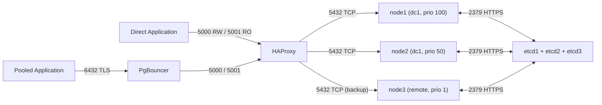

# Consensus, Routing, and Security Posture

This document explains how `patroni-lab-rhel8` coordinates leader election, database connection routing, and TLS encryption across its 8 containers, including differences between idealized hardening goals and current configuration files.

## End-to-End Request Topology

Contrary to earlier diagrams that placed HAProxy in front of PgBouncer, `pgbouncer/pgbouncer.ini` defines upstream aliases `postgres_rw` (`host=haproxy port=5000`) and `postgres_ro` (`host=haproxy port=5001`). PgBouncer therefore sits **ahead of** HAProxy for pooled clients, while direct PostgreSQL clients can connect straight to HAProxy ports `5000` or `5001`.

## Quorum and Multi-Datacenter Priority Design

The lab separates consensus and database tiers into three `etcd` nodes and three Patroni/PostgreSQL nodes:

1. **etcd Raft Quorum (`etcd1`, `etcd2`, `etcd3`):** A three-member Raft cluster tolerates the loss of one member (`(3 / 2) + 1 = 2` quorum). If two etcd nodes go down, the remaining single node stops granting leader leases, and Patroni demotes the primary PostgreSQL instance to read-only mode to prevent split-brain writes.
2. **Patroni Lease and Priority (`patroni/patroni.yml`):** Patroni configures `ttl: 30`, `loop_wait: 10`, `retry_timeout: 10`, `use_pg_rewind: true`, and a physical replication slot `pg_failover_slot`. Node environment tags in `docker-compose.yml` assign `dc1` with `failover_priority=100` to `node1`, `dc1` with `failover_priority=50` to `node2`, and `remote` with `failover_priority=1` to `node3`.
3. **Dynamic Role Discovery (`haproxy/haproxy.cfg`):** HAProxy backends `pg_primary` (`5000`) and `pg_replicas` (`5001`) poll each node's Patroni REST API on port `8008` over TLS (`/primary` and `/replica`). Node weights (`100`, `50`, `1` with `backup` on `node3`) prefer `dc1` nodes before routing to `remote`.

## Current TLS and Lab Security Posture

Although project specifications target strict End-to-End TLS and PROXY protocol v2, inspecting the actual configuration manifests shows important lab trade-offs to harden before production use:

- **PROXY protocol is not active:** `haproxy/haproxy.cfg` and `ansible/roles/haproxy/templates/haproxy.cfg.j2` forward plain TCP on port `5432` without `send-proxy-v2` on `server` entries.
- **Certificate verification flags are relaxed in lab defaults:** `.env`, `Dockerfile`, and `Dockerfile.base` set `PYTHONHTTPSVERIFY=0`; `haproxy/haproxy.cfg` specifies `check-ssl verify none` on Patroni API health checks; `etcd/etcd1.yml` sets `client-cert-auth: false`; and `ansible/verify.yml` uses `validate_certs: no`.
- **Plaintext lab artifacts exist in Git:** `.env`, `ansible/certs/*.key`, and `pgbouncer/userlist.txt` carry test credentials and keys for friction-free local execution, and `Dockerfile.base` configures SSH `root:rootpass`.
- **Certificate directory split:** `Makefile` `gen-certs` and `docker-compose.yml` use `certs_new/`, while host helper scripts such as `scripts/manage/status.sh` and `scripts/tests/stress_test.py` default to `certs/` unless `CERT_DIR` is overridden.

Keeping these distinctions explicit alongside [Reference: Architecture Ports and Environment](../03-reference/architecture-ports-and-env.md) prevents operators from assuming lab defaults enforce strict production mTLS validation.
