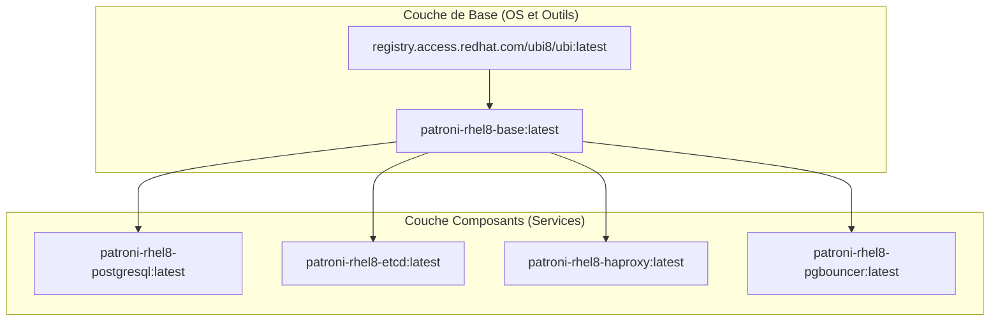

# 🐳 Guide des Images Docker

Ce document détaille la hiérarchie et le rôle de chaque image Docker utilisée dans le cluster Patroni Lab.

## 🏗️ Hiérarchie des Images

Toutes les images du projet reposent sur une image de base unique (`patroni-rhel8-base`) pour garantir la cohérence des versions de Python, des outils système et des certificats CA.

## 📋 Détails des Images

| Image | Fichier Source | Rôle Principal & Détails Techniques |
| :--- | :--- | :--- |
| `patroni-rhel8-base` | `Dockerfile.base` | **Fondation** : Python 3.12, outils système, dépôts PGDG/EPEL, clés SSH. |
| `patroni-rhel8-postgresql` | `Dockerfile.postgresql` | **Base de données** : PostgreSQL 17, Patroni 4.1.0, client `etcd`. Géré par `supervisord`. |
| `patroni-rhel8-etcd` | `Dockerfile.etcd` | **DCS** : etcd 3.6. Gère le quorum via `entrypoint_etcd.sh`. |
| `patroni-rhel8-haproxy` | `Dockerfile.haproxy` | **Ingress** : HAProxy pour le routage TCP RW/RO et les statistiques HTTPS (`/certs/haproxy.pem`). |
| `patroni-rhel8-pgbouncer`| `Dockerfile.pgbouncer`| **Pooling** : PgBouncer avec TLS client/serveur et `userlist.txt` généré depuis `.env`. |

*(Le fichier racine `Dockerfile` constitue l'image historique tout-en-un antérieure au découpage modulaire.)*

## 🚀 Processus de Construction

La construction est orchestrée par le `Makefile` afin de garantir que l'image de base est prête avant les services dépendants :

1. **Construction de l'image de base** : `docker build -t patroni-rhel8-base:latest -f Dockerfile.base .`
2. **Construction des images composants** : `make build` enchaîne `build-etcd`, `build-postgres`, `build-haproxy` et `build-pgbouncer`.

---
[Retour à l'accueil (FR)](../README.fr.md)
